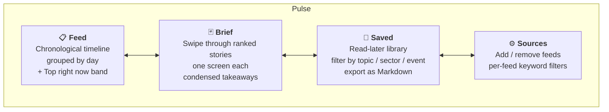
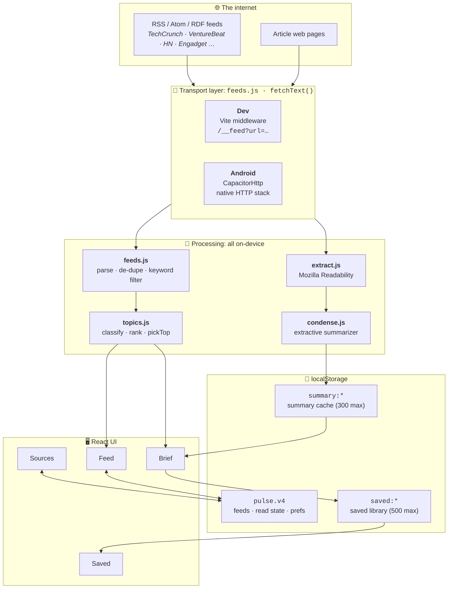
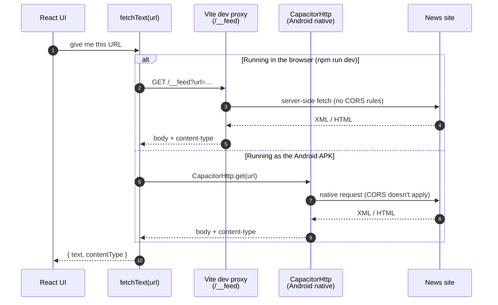
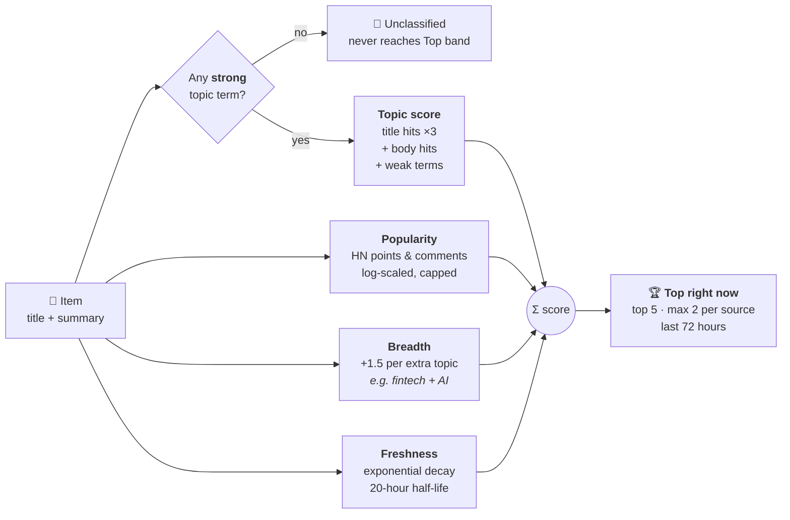
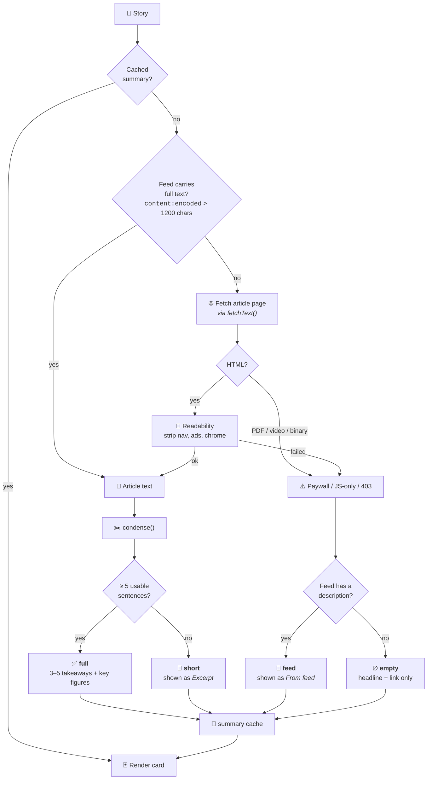
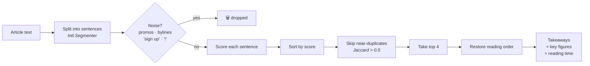
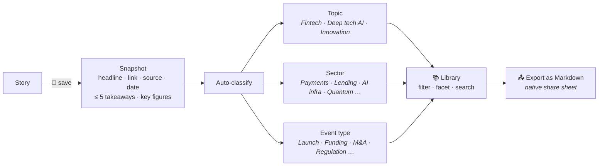

<div align="center">

# ⚡ Pulse

### A personal news reader for **innovation**, **fintech**, and **deep tech AI**: it ranks the stories that matter and condenses them into 15-second briefs, entirely on-device.


</div>

---

## 🧭 Why Pulse exists

Tech news has a volume problem. One TechCrunch homepage feed produces more headlines in a day than anyone can read, and most of them aren't news: they're promos, rewrites, or phone reviews. And when a headline *does* matter, the feed only gives you a single line about it.

Pulse fixes both halves of that:

| Problem | What Pulse does |
|---|---|
| 🌊 **Too much noise** | Pulls only topic-specific feeds, then classifies every item into *Innovation*, *Fintech*, or *Deep tech AI*. Anything that fits none of them never reaches the top. |
| 🎯 **No sense of priority** | Scores each story on topic strength, popularity, cross-topic breadth, and freshness, then surfaces a **Top right now** band. |
| 📰 **Headlines don't say what happened** | **Brief mode** fetches the full article, extracts the body, and condenses it to 3–5 key sentences plus key figures ($ amounts, %, funding rounds). |
| 🔖 **Good stories get lost** | **Saved** keeps a compact snapshot of each story you save, with filters by topic, sector, and event type, and a Markdown export. |
| 💸 **AI summarizers cost money and leak data** | Summarization is **extractive and local**: no LLM, no API key, no server. Everything runs on your phone. |

---

## 📱 The four tabs



---

## 🏗️ Architecture at a glance

Pulse has **no backend**. It's a React app that runs in your browser during development and inside an Android WebView once packaged. All state lives in `localStorage` on the device.



---

## 🚚 The one tricky bit: CORS

News sites don't send CORS headers, so a browser won't let JavaScript read their feeds. Pulse gets around this with **two transports behind one function**, so the rest of the app never needs to know which one it's using:



> ⚠️ **Rule for contributors:** every outbound request goes through `fetchText()`. A bare `fetch()` works in dev and **fails silently in the APK**.

---

## 🎯 How stories get ranked

Every item is scored by `topics.js`. Each topic has two keyword tiers: **strong** terms that are unambiguous ("stablecoin", "foundation model", "unveils"), and **weak** terms that only count once a strong term has already matched. That way, a phone review mentioning "new model" doesn't get filed as deep tech.



```
score = (topicScore + popularity + 1.5 × extraTopics) × (0.35 + 0.65 × freshness)
```

The per-source cap keeps one prolific feed from taking over the whole band.

---

## 🃏 Brief mode: from headline to 15-second summary

RSS descriptions are usually one line, and Hacker News items carry no article text at all. So Brief mode runs a **fetch → extract → condense** pipeline, and **degrades honestly** when a step comes up short instead of showing a blank card.



Brief also **prefetches the next 2 stories** (max 2 requests at once), so swiping feels instant. A story is marked read after 2 seconds on screen.

### ✂️ How `condense()` picks sentences

There's no LLM involved. Each sentence is scored on signals that tend to mark *news* rather than filler, and then the best non-redundant ones are put back in their original reading order.



| ➕ Boosts | ➖ Penalties |
|---|---|
| Lead position (1st +3, 2nd +2, 3rd +1) | Last 15% of article (−2) |
| Numbers, `$` amounts, `%` (up to +4) | Addresses the reader: "you", "your" (−4) |
| Named entities (up to +3) | Company boilerplate: "was founded in…" (−3) |
| Topic keywords (up to +4) | Starts with a pronoun: "He said…" (−2) |
| Reporting verbs: *raised, launched, acquired* (+2) | Hedging: *could, may, reportedly* (−1) |
| | Direct quotes (−1) |

The weights are tuned with `tune.mjs`, a standalone harness that runs the algorithm against a live feed. See [`TUNING.md`](TUNING.md).

```bash
node tune.mjs --feed https://techcrunch.com/category/fintech/feed/ --verbose
```

---

## 🔖 Saved: a read-later library that stays small



**Design rule:** Saved stores the *derived summary and the link*, never the article body. That cap is enforced in `saved.js` itself, so Saved can't quietly grow into an archive of copyrighted text. If you save something from Feed before Brief has summarized it, the summary gets **backfilled** later, once Brief has one.

---

## 📡 Default sources

Topic-specific feeds instead of homepage firehoses cut the volume by roughly an order of magnitude before any filtering even starts.

| Source | Feed | Focus |
|---|---|---|
| TechCrunch AI | `techcrunch.com/category/artificial-intelligence/feed/` | Deep tech AI |
| VentureBeat AI | `venturebeat.com/category/ai/feed/` | Deep tech AI |
| TechCrunch Fintech | `techcrunch.com/category/fintech/feed/` | Fintech |
| TechCrunch Funding | `techcrunch.com/tag/funding/feed/` | Innovation / venture |
| Hacker News | `hnrss.org/frontpage?points=150&count=50` | Only stories with 150+ points |
| Engadget | `engadget.com/rss.xml` | Keyword-filtered to launches |
| CB Insights | `cbinsights.com/research/feed/` | *Unverified* |

You can add anything with an RSS/Atom feed from the **Sources** tab. Tips for finding feeds:

- Try `/feed`, `/rss`, `/atom.xml`, `/index.xml`, or `/feed.xml` after the domain
- GitHub releases: `https://github.com/OWNER/REPO/releases.atom`
- Email-only newsletters: use an email-to-RSS bridge such as *Kill the Newsletter*

---

## 🚀 Getting started

### Run it in the browser

Requires **Node.js** (LTS).

```bash
npm install
npm run dev
```

Open `http://localhost:5173`, then tap **Check now**.

### Build the Android APK

Requires **Android Studio** and **JDK 17**. Android Studio's bundled JDK is too new for this Gradle version.

```bash
npx cap add android     # first time only
npm run apk
```

The APK lands at `android/app/build/outputs/apk/debug/app-debug.apk`. Copy it to your phone and allow installs from unknown sources.

You'll also need `android/local.properties` pointing at your SDK. It isn't committed because it contains your local path:

```properties
sdk.dir=C\:\\Users\\<you>\\AppData\\Local\\Android\\Sdk
```

> 💡 New to all this? [`SETUP.md`](SETUP.md) walks through installing Node, Git, and Android Studio from scratch.

| Script | What it does |
|---|---|
| `npm run dev` | Dev server with the feed proxy |
| `npm run build` | Production web build into `dist/` |
| `npm run apk` | Build → sync to Android → `assembleDebug` |
| `npm run android` | Build → sync → open in Android Studio |

---

## 🗂️ Project layout

```
src/
├── App.jsx             screen shell, filtering, day grouping, tab switching
├── BriefMode.jsx       swipeable cards, prefetching, the failure ladder
├── SavedScreen.jsx     library view, facets, Markdown export
├── SourcesScreen.jsx   feed management
├── TabBar.jsx          bottom navigation
├── styles.css          all styling, driven by CSS tokens in :root
└── lib/
    ├── feeds.js        fetchText() transport + RSS/Atom/RDF parsing
    ├── topics.js       topic / sector / event classification, ranking
    ├── extract.js      article extraction with Mozilla Readability
    ├── condense.js     local extractive summarizer
    ├── summaryCache.js per-story summary cache
    ├── saved.js        read-later store + export
    └── storage.js      feeds, read state, prefs (versioned key)
vite.config.js          dev-only /__feed proxy
tune.mjs                CLI harness for tuning condense weights
```

### Design docs

| Doc | Covers |
|---|---|
| [`PRD.md`](PRD.md) | Product requirements for Brief mode + visual refresh |
| [`BRIEF-MODE.md`](BRIEF-MODE.md) | Brief pipeline spec and failure ladder |
| [`SAVED.md`](SAVED.md) | Saved library spec and storage rules |
| [`DESIGN.md`](DESIGN.md) | Visual system: tokens, type scale, motion |
| [`TUNING.md`](TUNING.md) | How to tune the summarizer |

---

## 🧱 Principles

- **Local-first.** No accounts, no server, no analytics. Your reading history never leaves the device.
- **Free to run.** No LLM calls, no API keys, no metered services.
- **Honest degradation.** When a summary isn't possible, the card says so (*Excerpt*, *From feed*) instead of guessing.
- **Boring code.** Plain React hooks. No Redux, no router, no component library, no CSS framework.

## ⚠️ Known limitations

- Paywalled and JavaScript-rendered articles can't be extracted, so those fall back to the feed description.
- Fonts load from Google Fonts, so titles use system fonts when you're offline.
- Read state and Saved live on the device, so uninstalling the app clears them.
- PitchBook has no public feed. The only route is email alerts through an RSS bridge.
